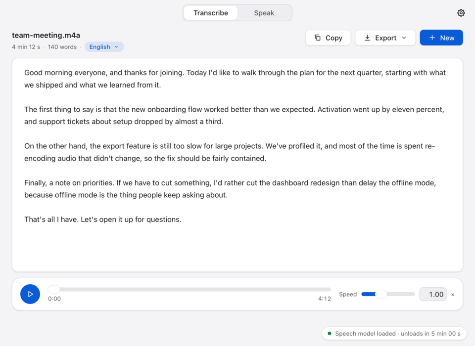

# Parlo

A fully local macOS app: **speech → text** (audio/video files and long microphone recordings, multilingual) and **text → speech** (21 English voices + Spanish, Kyutai PocketTTS). Tauri v2 (Rust) + Vue 3. After the models are installed it never touches the network.



## Where things are
| | |
|---|---|
| `docs/BRIEF.md` | requirements, architecture, targets, phases (source of truth) |
| `docs/STATUS.md` | current state, measurements, what's next / needs the owner |
| `docs/DECISIONS.md` | every meaningful decision (context · alternatives · decision · why) |
| `docs/MAC_HANDOFF.md` | what still needs macOS (checklist with verification steps) |
| `docs/QA-CHECKLIST.md` | manual QA (recording interruptions, UI review, acceptance scenarios) |
| `crates/parlo-core` | audio, recorder, STT/TTS pipelines, text import, jobs, model lifecycle (portable Rust) |
| `crates/parlo-cli` | headless access to all of it (tests, benchmarks): `decode · record · transcribe · lang · speak · bench · recover` |
| `crates/parlo-macos` | macOS platform code (objc2): PDFKit, AVFoundation fallback decoder, AAC encoder, power/sleep/memory, mic permission |
| `crates/pocket-tts` | vendored + patched Candle port of PocketTTS (see `PATCHES.md`) |
| `src-tauri` | the app shell: typed IPC (`tauri-specta`), window lifecycle, menu, notifications |
| `ui` | Vue 3 + Pinia UI; runs in a browser with a mock backend (`VITE_MOCK_BACKEND=1`) |
| `spike/` | Phase-0 evidence: TTS parity gate, STT model bench |

Commands are listed in [`CLAUDE.md`](CLAUDE.md#commands).

## Build from scratch (macOS 14+, Apple silicon; tested on macOS 26.4, M4 Pro)
Only the Xcode **Command Line Tools** are needed (no full Xcode: Metal shaders compile at runtime).
```bash
xcode-select --install                                   # once
brew install cmake node rust                             # rust via rustup also works; Node >= 22
cargo install tauri-cli --locked --version '^2'          # `cargo tauri`; make sure ~/.cargo/bin is on PATH
git clone <repo> ~/Projects/parlo && cd ~/Projects/parlo
scripts/fetch-models.sh                                  # ~3.9 GB total, pinned + SHA-256 verified (build time only)
scripts/build-app.sh                                     # -> dist/Parlo.app (1.1 GB, arm64, min macOS 14)
```
`build-app.sh` fetches/verifies the models, builds the UI, runs `cargo tauri build` with `whisper-metal` (Metal STT) and
`tts-accelerate` (Candle + Apple Accelerate TTS — faster than Candle-Metal here, see DECISIONS C-015), copies the models
into `Contents/Resources/models/`, and signs with the hardened runtime + microphone entitlement. Options: `--dmg`,
`--no-metal`, `--skip-models`.

### Install
```bash
rm -rf /Applications/Parlo.app && cp -R dist/Parlo.app /Applications/ && open /Applications/Parlo.app
```
Not notarized: if Gatekeeper complains on a copy from another Mac, `xattr -dr com.apple.quarantine /Applications/Parlo.app`.

## Keeping the microphone permission across rebuilds
macOS ties the microphone permission (TCC) to the app's code signature. An ad-hoc signature (the default of `build-app.sh`
without a certificate) changes on every build, so macOS asks again after each rebuild. Create a self-signed code-signing
certificate once and the permission survives (verified: rebuilt and re-ran the mic test without a new prompt):

1. *Keychain Access → Certificate Assistant → Create a Certificate…*
2. Name: **Parlo Local Signing**, Identity Type: *Self Signed Root*, Certificate Type: *Code Signing*.
3. `export PARLO_SIGN_IDENTITY="Parlo Local Signing"` before `scripts/build-app.sh` (add it to your shell profile).

`security find-identity -p codesigning` lists it as `CSSMERR_TP_NOT_TRUSTED`; that is normal for a self-signed
certificate and `codesign` still uses it. The app's designated requirement is pinned to the certificate, so the identity is
stable across builds.

## Data locations
| | |
|---|---|
| `~/Library/Application Support/Parlo/` | `settings.json`, `workspace.json`, `recordings/` (never auto-deleted), `outputs/` (generated speech, cleanable in Settings), `jobs/<id>/` (checkpoints) |
| `~/Library/Caches/Parlo/` | temporary decoded audio — safe to delete |
| `~/Library/Logs/Parlo/` | rotating local logs |
| `Parlo.app/Contents/Resources/models/` | Whisper large-v3-turbo q8_0, Silero VAD, PocketTTS English + Spanish models with 22 voices (`models/` in a dev checkout) |
`PARLO_HOME=<dir>` redirects all three user directories (tests, self-tests).

## Tests, self-tests and benchmarks
```bash
scripts/gen-fixtures.sh                    # synthetic speech (say/espeak-ng), formats, edge files; add --only fleurs / --long2h
cargo test --workspace                     # portable + real-engine tests (needs models + fixtures; macOS adds parlo-macos/tests/platform.rs)
npm --prefix ui ci && npm --prefix ui test # UI stores/contract tests
PARLO_TEST_WHISPER=ggml-small-q8_0.bin cargo test -p parlo-core --test stt_real   # quicker (weaker model) run
# CLI built like the app:
cargo build --release -p parlo-cli --features parlo-core/whisper-metal,parlo-core/tts-accelerate
target/release/parlo-cli transcribe file.mp3 --json         # prints rtf; use /usr/bin/time -l for peak RSS
target/release/parlo-cli bench tts --repeat 5               # RTF, time to first audio, load, RSS
scripts/tts-parity.sh                                       # Python reference vs Candle (long); spike/tts-parity/speed_bench.py = quick speed gate
# the bundled app:
PARLO_SELFTEST=1 dist/Parlo.app/Contents/MacOS/parlo        # command layer with the real engines (prints PARLO_SELFTEST_OK)
scripts/measure-idle-memory.sh                              # window open / closed / after-job footprints (~3 min)
scripts/check-offline.sh --cli target/release/parlo-cli --app dist/Parlo.app    # deny-network sandbox + lsof sampling
scripts/mac-mic-test.sh 12                                  # real microphone in the bundled app (shows the TCC prompt once)
scripts/mac-memory-pressure-test.sh                         # simulated memory warning unloads the engines (needs sudo)
```
Measured numbers (with commit and date) are in `docs/STATUS.md`.

## Architecture in one page
* **`parlo-core`** (portable Rust) owns everything: crash-safe recorder (SPSC ring → WAV writer, 2 s header sync, gap markers,
  device follow, sleep/wake), streaming decode + resample, the STT pipeline (Silero VAD → ≤ 30 s chunks → whisper.cpp,
  checkpoints, language vote, hallucination filters), the TTS pipeline (chunking, streaming segments, content-addressed cache,
  resume), text import (txt/md/docx/epub/pdf), the model lifecycle (lazy load, idle unload, memory pressure) and the job manager.
  OS differences are small traits in `platform/`.
* **`parlo-macos`** implements those traits with objc2: PDFKit text, AVFoundation fallback decoder, AudioToolbox AAC/M4A,
  `NSProcessInfo` power assertions (App Nap off while recording/working), sleep/wake, memory-pressure source, mic permission.
* **`src-tauri`** is a thin Tauri v2 shell: ~33 typed commands + events (`tauri-specta` → `ui/src/bindings.ts`), the window is
  *destroyed* on close (recordings/jobs continue in the core; Dock click recreates it), menus, notifications, single instance.
  `main.rs` sets `MallocLargeCache=0` (C-017) so freed model memory returns to the OS; engines are released on exit (C-016).
* **`ui`** is Vue 3 + Pinia: all state machines in stores, one `Backend` interface (real adapter over the bindings, mock for
  browser development).
* Inference: whisper.cpp (Metal) via `whisper-rs`; PocketTTS via the vendored Candle port (Accelerate). Zero network at runtime.

## Licenses
Parlo: MIT. Models: Whisper (MIT), Silero VAD (MIT), Kyutai PocketTTS (code MIT; weights CC-BY-4.0 — attribution: Kyutai). LAME (LGPL) is statically linked for MP3 export: fine for personal use, flag it before any distribution. See `models/manifest.toml` and the app's About pane.
