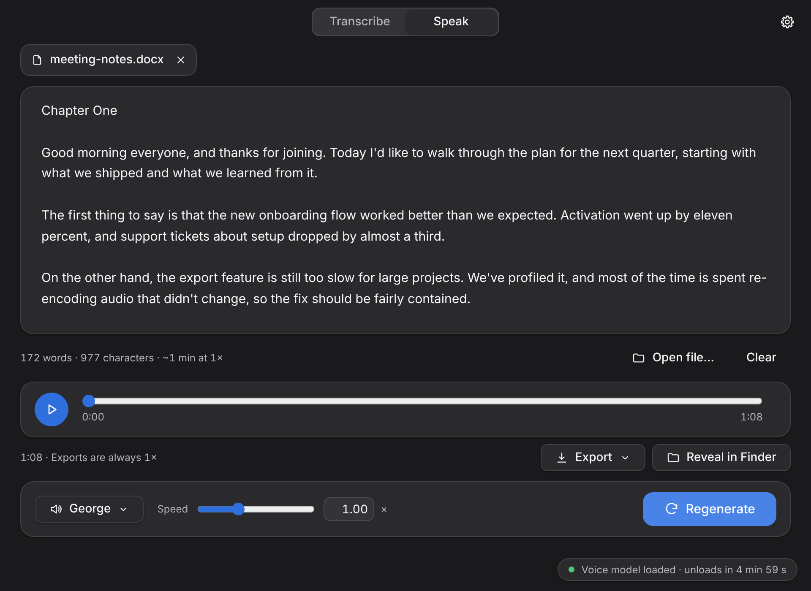
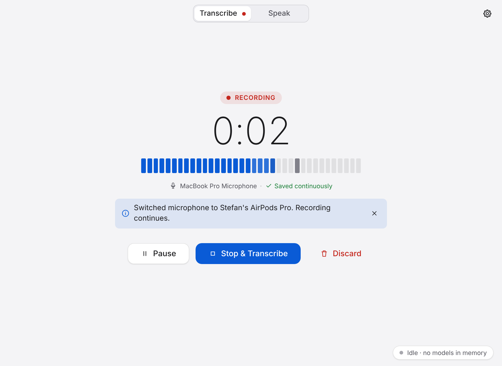
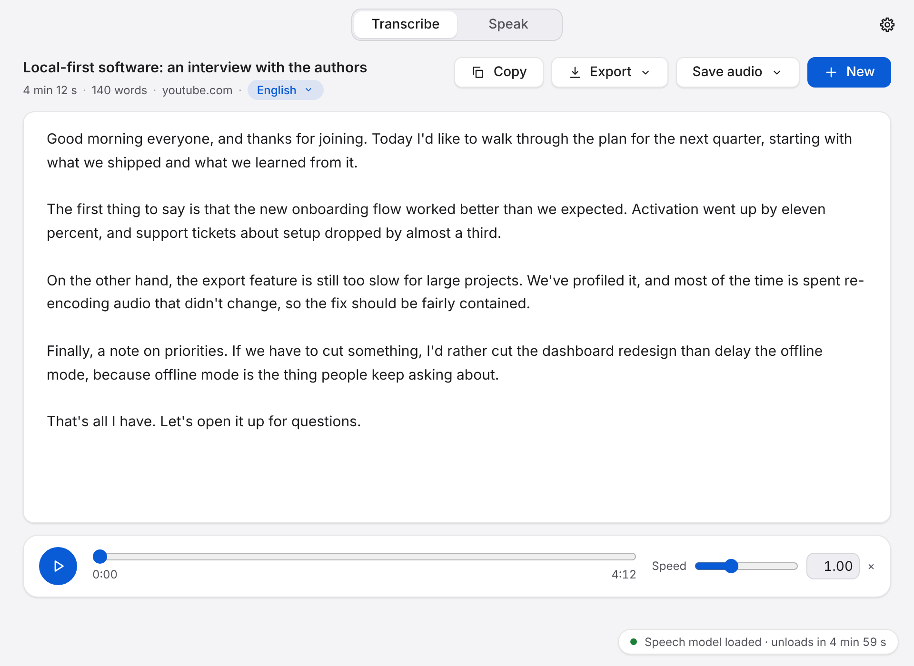
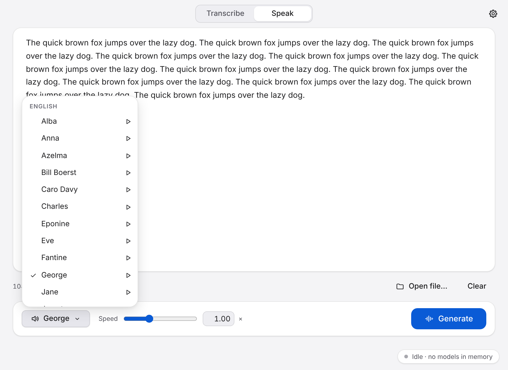
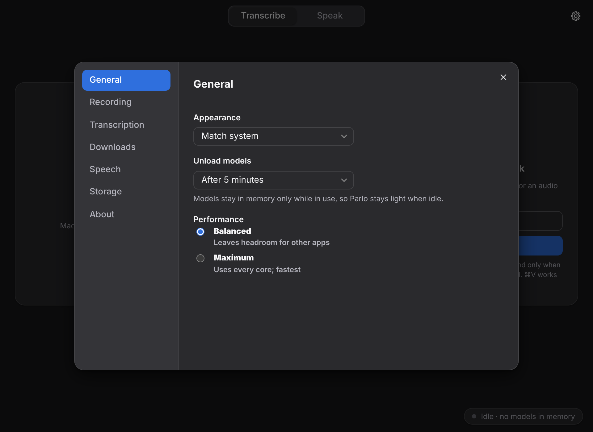

# Parlo

**Speech to text and text to speech on your Mac, fully offline.**

Parlo transcribes recordings, audio and video files, and links, in almost any language. It also reads text and
documents aloud in English or Spanish. Everything runs on your Mac: nothing is ever uploaded, and there is no account,
telemetry or subscription.

<p align="center">
  
  
</p>

## Features

**Transcribe**
- Record with your microphone, for hours if needed. Recordings are saved safely while you record, so a crash or a
  closed lid doesn't lose them.
- Drop in an audio or video file: MP3, M4A, WAV, FLAC, OGG, Opus, AIFF, MP4/MOV and more.
- Paste a link (YouTube, a podcast episode, an audio file) and Parlo downloads just the audio and transcribes it.
- The language is detected automatically, and you can change it with one click. Powered by Whisper large-v3-turbo.
- Edit the transcript, copy it, or export it as `.txt` or `.md`.

**Speak**
- Type or paste text, or open a document: `.txt`, `.md`, `.docx`, `.pdf`, `.epub`, up to book length.
- 19 English voices and 2 Spanish voices (Lola, Enrique), each with a preview. Powered by Kyutai PocketTTS.
- Playback starts while the rest is still being generated. Export as WAV, M4A or MP3.

| | |
|---|---|
|  |  |
|  |  |

## Requirements

- A Mac with **Apple silicon** (M1 or newer). Intel Macs are not supported.
- **macOS 14 Sonoma** or newer.
- About **1.6 GB** of free disk space. The speech models are included in the download, so Parlo works offline from the
  first launch.

## Install

1. Download **Parlo.dmg** from the [latest release](https://github.com/stefannik/parlo/releases/latest).
2. Open the DMG and drag **Parlo** into **Applications**.
3. Open Parlo from Applications. The first time, macOS will stop it (see below).

### "Apple could not verify Parlo…": opening it the first time

Parlo is free and open source, but it isn't signed with a paid Apple Developer ID. So the first time you open it, macOS
shows a warning such as *"Apple could not verify 'Parlo' is free of malware"*. You only need to do this once:

1. Open Parlo and click **Done** on the warning (don't move it to the Bin).
2. Open **System Settings → Privacy & Security** and scroll down to **Security**. You'll see *"Parlo" was blocked to
   protect your Mac*.
3. Click **Open Anyway**, confirm with your password or Touch ID, then click **Open**.

After that, Parlo opens normally.

<details>
<summary>On macOS 14 Sonoma, or if macOS says Parlo "is damaged"</summary>

- **macOS 14:** in Finder, **right-click** (or Control-click) Parlo in Applications, choose **Open**, then click **Open**
  again in the dialog.
- **"Parlo is damaged and can't be opened"**: this is the same download check, not real damage. Open **Terminal** and
  run:
  ```bash
  xattr -dr com.apple.quarantine /Applications/Parlo.app
  ```
  Then open Parlo again.
</details>

### Microphone permission

The first time you record, macOS asks whether Parlo may use the microphone. Click **Allow**. If you clicked *Don't
Allow* by mistake, turn Parlo on in **System Settings → Privacy & Security → Microphone**.

## Using Parlo

- **Transcribe:** press the record button, or drop a file onto the window, or paste a link (⌘V). When it's done, edit,
  **Copy** or **Export** the text. Click the language badge to re-transcribe in another language.
- **Speak:** type or paste text, or drop a document onto the window. Pick a voice (▶ plays a preview), choose a speed
  and press **Generate** (⌘↩). Use **Export** to save the audio.
- **Settings** (gear icon): default voice, how long recordings are kept, storage cleanup, and link downloads.

Your data lives in `~/Library/Application Support/Parlo/`. Recordings that haven't been transcribed are never deleted
automatically.

## Privacy

Parlo works offline. The one exception is **Transcribe a link**: when you paste a link, Parlo downloads the audio from
that site using the bundled [yt-dlp](https://github.com/yt-dlp/yt-dlp). Nothing is ever uploaded: no audio, no text, no
analytics. You can turn link downloads off in Settings → Downloads.

## Good to know

- Spanish voices currently speak with a **Latin American accent**, including Enrique. The Spanish model pronounces words
  that way regardless of the voice.
- Transcription speed depends on your Mac. On an M4 Pro, an hour of audio takes about 2 minutes.
- YouTube sometimes needs extra steps for private or age-restricted videos. See Settings → Downloads.

## Uninstall

Move **Parlo** from Applications to the Bin. To remove your data too, delete `~/Library/Application Support/Parlo`,
`~/Library/Caches/Parlo` and `~/Library/Logs/Parlo`.

## Building from source

See [docs/DEVELOPING.md](docs/DEVELOPING.md).

## License

Parlo is released under the [MIT License](LICENSE). The bundled models, voices and tools have their own licenses, listed
in [THIRD_PARTY_LICENSES.md](THIRD_PARTY_LICENSES.md). Speech synthesis uses Kyutai's PocketTTS (CC-BY-4.0) and speech
recognition uses OpenAI's Whisper (MIT).
